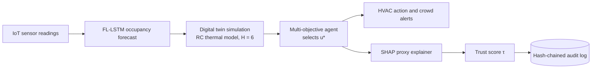

# XFADT — Explainable Federated Agentic Digital Twin

[](https://github.com/ai-vnv/XFADT-Smart-Campus/actions)
[](https://www.python.org/downloads/)
[](LICENSE)
[](https://fastapi.tiangolo.com)
[](https://flower.dev)

> Privacy-preserving, explainable, multi-objective optimization of campus HVAC, comfort, and crowd management through federated learning, digital twin simulation, and SHAP-based governance.

---

## Table of Contents

- [Overview](#overview)
- [Key Capabilities](#key-capabilities)
- [Architecture](#architecture)
- [Repository Structure](#repository-structure)
- [Requirements](#requirements)
- [Installation](#installation)
- [Quick Start](#quick-start)
- [Usage](#usage)
- [Configuration](#configuration)
- [Dataset](#dataset)
- [Reproducing the Results](#reproducing-the-results)
- [Results](#results)
- [Limitations](#limitations)
- [Testing and CI](#testing-and-ci)
- [Development](#development)
- [Troubleshooting](#troubleshooting)
- [Contributing](#contributing)
- [License](#license)

---

## Overview

XFADT is a research framework for building-level resource optimization on a smart campus. For each building it combines:

- a **federated occupancy forecaster** (an LSTM trained with Flower and differential privacy, so raw sensor data stays with each building),
- a **digital twin** (a first-order RC thermal model) that simulates candidate HVAC actions,
- a **multi-objective agent** that trades off energy, thermal comfort, and crowd density,
- an **explainability and governance layer** that attaches SHAP attributions, a trust score, and a hash-chained audit record to every decision.

The repository includes the synthetic dataset generator, training and evaluation pipelines, a REST API, a Streamlit dashboard, and Docker Compose services.

> [!NOTE]
> All experiments in this repository use a **synthetic** dataset. Building thermal parameters in [`configs/building_params.yaml`](configs/building_params.yaml) are design constants, not measurements from real buildings.

---

## Key Capabilities

- **Synthetic campus dataset** — 12 buildings, 14 features, 30-second resolution, with Normal, Peak (exam months), and Failure (sensor fault) scenarios.
- **Federated learning with differential privacy** — FedAvg over building clients, gradient clipping, and Gaussian noise calibrated per round; privacy cost audited with the Opacus RDP accountant.
- **Digital twin what-if simulation** — RC thermal model evaluated over a 6-step horizon for every candidate action.
- **Multi-objective decision agent** — selects the feasible action that minimizes a weighted energy/comfort/density utility.
- **Explainability and trust** — SHAP attributions from a gradient-boosted proxy of the LSTM, combined with comfort and safety alignment into a trust score τ.
- **Tamper-evident audit log** — SHA-256 hash-chained decision records (JSONL and SQLite backends) with chain verification.
- **Serving and monitoring** — FastAPI REST server, Streamlit governance dashboard, MLflow experiment tracking, and Docker Compose deployment.

---

## Architecture

### Decision Cycle

XFADT is configured for a 30-second decision interval (`pipeline.decision_interval_s` in [`configs/hyperparams.yaml`](configs/hyperparams.yaml)). Each cycle runs the following stages for one building:



1. **Forecast** — the federated LSTM predicts next-step occupancy from a 12-step (6-minute) window of 14 features.
2. **Simulate** — the digital twin rolls each candidate HVAC action forward and scores energy $E(u)$, comfort $C(u)$, and density risk $D(u)$.
3. **Decide** — the agent selects the optimal feasible action.
4. **Explain** — SHAP values are computed on a gradient-boosted proxy model fitted to the LSTM's predictions.
5. **Score trust** — SHAP coherence, comfort alignment, and safety alignment are combined into τ.
6. **Audit** — the decision, explanation, and trust score are appended to a hash-chained log.

A detailed description of components and data flow is available in [`docs/architecture.md`](docs/architecture.md).

### Components

| Module | Role |
|--------|------|
| [`data/generation/`](data/generation/) | Synthetic dataset generation: occupancy model, thermal simulator, sensor fault injector |
| [`models/lstm/`](models/lstm/) | `OccupancyLSTM` (2 layers, 128 hidden units) and local training |
| [`federated/`](federated/) | Flower client, FedAvg server strategy, DP mechanism, simulation entry point |
| [`digital_twin/`](digital_twin/) | RC thermal model and action simulator |
| [`agent/`](agent/) | Discrete action space, utility function, optimizer |
| [`xai/`](xai/) | SHAP proxy explainer, trust scorer, audit logger |
| [`pipeline/`](pipeline/) | End-to-end decision cycle orchestrator |
| [`evaluation/`](evaluation/) | Metrics (ERR, CCS, CSS, MAE, τ, SHF) and baseline runner |
| [`api/`](api/) | FastAPI REST server |
| [`governance/dashboard/`](governance/dashboard/) | Streamlit governance dashboard |

### Methodology

**Thermal model.** Indoor temperature follows a first-order RC model with per-building parameters:

$$\frac{dT_{\text{in}}}{dt} = \alpha (T_{\text{out}} - T_{\text{in}}) + \beta Q_{\text{HVAC}} + \gamma \kappa o$$

where $o$ is occupancy and $\kappa = 0.1$ kW/person. The comfort band used for feasibility and scoring is **20–26 °C**.

**Utility function.** The agent selects

$$u^* = \arg\min_{u \in U_{\text{feas}}} \left[ \lambda_e E(u) - \lambda_c C(u) + \lambda_d D(u) \right]$$

with configured weights $\lambda_e = 0.5$, $\lambda_c = 0.35$, $\lambda_d = 0.15$. The authors report selecting these weights by grid search over $[0, 1]$ in steps of 0.05, subject to $\lambda_e + \lambda_c + \lambda_d = 1$; the search script itself is not included in this repository.

**Trust score.** For the selected action,

$$\tau(u^*) = \eta_1 \frac{\sum_{\phi_j > 0} \phi_j}{\sum_j |\phi_j|} + \eta_2 C(u^*) + \eta_3 \left(1 - D(u^*)\right)$$

with $\eta_1 = 0.5$, $\eta_2 = 0.3$, $\eta_3 = 0.2$, where $\phi_j$ are the SHAP values.

**Differential privacy.** Each FL round applies the Gaussian mechanism with $(\varepsilon = 1.0, \delta = 10^{-5})$, clipping norm $C = 1.0$, and noise multiplier $\sigma = \sqrt{2\ln(1.25/\delta)}/\varepsilon \approx 4.845$. See [Privacy Accounting](#privacy-accounting) for the composed budget.

---

## Repository Structure

```text
XFADT-Smart-Campus/
├── agent/                  # Action space, utility function, optimizer
├── api/                    # FastAPI server (api/main.py)
├── configs/
│   ├── hyperparams.yaml    # Data, model, FL, DP, agent, XAI, pipeline settings
│   └── building_params.yaml# Per-building RC thermal parameters (B01–B12)
├── data/
│   ├── generation/         # Synthetic dataset generator
│   ├── raw/                # Generated per-building Parquet files + manifest
│   └── audit/              # Audit log output
├── digital_twin/           # RC thermal model and simulator
├── docs/architecture.md    # Architecture reference
├── evaluation/             # Metrics and baseline runner
├── federated/              # Flower client/server, DP mechanism, simulation
├── governance/dashboard/   # Streamlit dashboard (app.py)
├── models/
│   ├── lstm/               # LSTM architecture, local training, checkpoints
│   └── shap/               # Persisted SHAP proxy explainers
├── monitoring/             # Prometheus configuration
├── notebooks/              # Data exploration, FL analysis, decision cycle demo
├── pipeline/               # Decision cycle orchestrator
├── results/                # Evaluation outputs (ablation/, dp_audit.json)
├── scripts/                # Evaluation, ablation, privacy, validation utilities
├── tests/                  # Unit, API, leakage, pipeline, and smoke tests
├── xai/                    # SHAP explainer, trust scorer, audit logger
├── Dockerfile
├── docker-compose.yml
├── Makefile
├── reproduce.sh / reproduce.bat
├── requirements.txt
└── requirements-dev.txt
```

---

## Requirements

| Requirement | Notes |
|-------------|-------|
| Python **3.10 or 3.11** | Required by [`pyproject.toml`](pyproject.toml); the pinned `torch==2.1.2` does not provide wheels for Python 3.12+ |
| pip | Dependencies are pinned in [`requirements.txt`](requirements.txt) and [`requirements-dev.txt`](requirements-dev.txt) |
| GNU Make + POSIX shell | Optional; needed only for `make` targets |
| Docker with Compose | Optional; needed only for [Docker Compose](#docker-compose) |

CI runs on Ubuntu with Python 3.10 and 3.11 on CPU-only GitHub-hosted runners.

---

## Installation

### Linux and macOS

```bash
git clone https://github.com/ai-vnv/XFADT-Smart-Campus.git
cd XFADT-Smart-Campus

python3 -m venv venv
source venv/bin/activate

python -m pip install --upgrade pip
pip install -r requirements.txt
pip install -r requirements-dev.txt
```

### Windows

Using PowerShell:

```powershell
git clone https://github.com/ai-vnv/XFADT-Smart-Campus.git
cd XFADT-Smart-Campus

python -m venv venv
.\venv\Scripts\Activate.ps1

python -m pip install --upgrade pip
pip install -r requirements.txt
pip install -r requirements-dev.txt
```

If you use Git Bash, activate the environment with `source venv/Scripts/activate` instead. This is also what `make env` does, so that target only works in a Windows shell environment.

### Verify the Installation

Run the smoke test suite from the repository root:

```bash
python tests/smoke_test.py
```

It checks critical imports, data flow, and pipeline initialization, and is designed to finish in under a minute.

> [!IMPORTANT]
> Run all commands from the repository root. Modules are invoked with `python -m <package>.<module>` and resolve imports relative to that directory.

---

## Quick Start

The following sequence mirrors the CI pipeline. It generates a small dataset (2 buildings, 7 days), runs a 3-round federated simulation, trains one local checkpoint, and evaluates it. It completes in minutes on a CPU.

```bash
# 1. Generate a small synthetic dataset
python -m data.generation.generate_dataset --n-buildings 2 --n-days 7

# 2. Run a short federated learning simulation
python -m federated.simulation --n-rounds 3 --n-buildings 2 --seed 42

# 3. Train a local checkpoint for building B01
python -m models.lstm.train_local --building-id B01 --data-path data/raw

# 4. Evaluate the checkpoint (the 7-day dataset only covers January)
python scripts/evaluate_checkpoint.py --checkpoint-dir models/lstm/checkpoints --data-dir data/raw --test-months 1 --n-buildings 1 --output results/quickstart_results.json
```

The metrics are written to `results/quickstart_results.json` under the `results` key.

> [!WARNING]
> These commands overwrite `data/raw/` and files in `models/lstm/checkpoints/`. Regenerate the full dataset before running the full-scale pipeline.

Shortcut equivalents are also available through Make: `make generate-quick` (2 buildings, 30 days) and `make train-quick` (3 buildings, 14 days, 5 rounds).

---

## Usage

### Dataset Generation

```bash
python -m data.generation.generate_dataset --config configs/hyperparams.yaml --building-config configs/building_params.yaml --n-buildings 12 --n-days 365 --seed 42
```

Equivalent: `make generate-data` (accepts `SEED=<n>`).

| Flag | Default | Description |
|------|---------|-------------|
| `--config` | `configs/hyperparams.yaml` | Global configuration |
| `--building-config` | `configs/building_params.yaml` | Per-building parameters |
| `--output-dir` | `data/raw` | Output directory for per-building files |
| `--n-buildings` | `12` | Number of buildings (taken in order from B01) |
| `--n-days` | `365` | Number of simulated days |
| `--start-date` | `2024-01-01` | First simulated day |
| `--seed` | `42` | Random seed |

Outputs:

- `data/raw/B01.parquet`, `data/raw/B02.parquet`, … — one file per building
- `data/raw/dataset_manifest.json` — seed, sizes, and SHA-256 hash of each file
- `data/scenarios/normal.parquet`, `peak.parquet`, `failure.parquet` — scenario splits

Validate the generated files against the manifest and report split sizes:

```bash
python scripts/validate_dataset.py --data-dir data/raw --config configs/hyperparams.yaml
```

### Federated Training

```bash
python -m federated.simulation --config configs/hyperparams.yaml --building-config configs/building_params.yaml --n-buildings 12 --seed 42
```

Equivalent: `make train-fl` (runs `make generate-data` first).

| Flag | Default | Description |
|------|---------|-------------|
| `--config` | `configs/hyperparams.yaml` | Global configuration |
| `--building-config` | `configs/building_params.yaml` | Per-building parameters |
| `--data-dir` | `data/raw` | Directory containing per-building Parquet files |
| `--n-rounds` | `federated.num_rounds` (100) | Number of FL rounds |
| `--n-buildings` | `12` | Number of building clients |
| `--no-dp` | off | Disable differential privacy |
| `--seed` | `42` | Random seed |

Checkpoints are written to `models/lstm/checkpoints/` (override with the `CHECKPOINT_DIR` environment variable):

- `global_round_XXXX.pkl` — global model parameters per round
- `Bxx_best.pt` — best-round global model unpacked per building
- `Bxx_best_scaler.pkl` — per-client feature scaler
- `Bxx_best_shap.pkl` — fitted SHAP proxy explainer

To train a single building without federation:

```bash
python -m models.lstm.train_local --building-id B01 --data-path data/raw --epochs 50
```

### Evaluation and Ablations

| Script | Purpose | Default output |
|--------|---------|----------------|
| [`scripts/evaluate_checkpoint.py`](scripts/evaluate_checkpoint.py) | Evaluate checkpoints on the held-out test split for all variants (or one via `--variant`) | `results/ablation/full_results.json` |
| [`scripts/run_ablations.py`](scripts/run_ablations.py) | Run all ablation variants for one seed | `results/ablation/ablation_seed{seed}.json` |
| [`scripts/multi_seed_eval.py`](scripts/multi_seed_eval.py) | Run evaluation across seeds; aggregate mean, std, 95% CI; Wilcoxon tests | `results/ablation/multi_seed_results.json` |
| [`scripts/run_experiment.py`](scripts/run_experiment.py) | Data generation → FL → evaluation in one command | `results/ablation/full_results.json` |
| [`scripts/compute_privacy_budget.py`](scripts/compute_privacy_budget.py) | Compose the DP budget over FL rounds | `results/dp_audit.json` |
| [`scripts/verify_publication_artifacts.py`](scripts/verify_publication_artifacts.py) | Check that required result files, checkpoints, and numeric metrics exist | console report |

Examples:

```bash
# Single-seed evaluation on the test months (Oct–Dec)
python scripts/evaluate_checkpoint.py --checkpoint-dir models/lstm/checkpoints --data-dir data/raw --test-months 10 11 12 --seed 42

# Ablations for one seed
python scripts/run_ablations.py --seed 42

# Multi-seed evaluation
python scripts/multi_seed_eval.py --seeds 42 0 1 --output results/ablation/multi_seed_results.json

# End-to-end experiment: --quick (3 buildings, 5 rounds, 14 days) or --full (12 buildings, 100 rounds, 365 days)
python scripts/run_experiment.py --quick

# Artifact check
python scripts/verify_publication_artifacts.py
```

Evaluated variants:

| Variant | Description |
|---------|-------------|
| XFADT (Full) | Full system with DP, XAI, and digital twin |
| -XAI | Trust score not produced (τ = 0) |
| -DT-WIF | Naive persistence forecast with rule-based HVAC |
| -DP | Federated learning without differential privacy |
| -MOO (energy-only) | Utility weights overridden to $\lambda_e = 1$, $\lambda_c = 0$, $\lambda_d = 0$ |
| -FL (centralized) | Centralized LSTM trained on the pooled dataset |
| Rule-Based | Baseline thermostat with naive persistence forecast |

### REST API

Start the server:

```bash
make api
# or
uvicorn api.main:app --host 0.0.0.0 --port 8000 --reload
```

Interactive documentation is served at [http://localhost:8000/docs](http://localhost:8000/docs).

| Method | Endpoint | Description |
|--------|----------|-------------|
| `GET` | `/health` | Health check |
| `GET` | `/status` | Number of buildings, SHAP calibration state, model state |
| `GET` | `/buildings` | Configured building IDs |
| `POST` | `/decide` | Run one decision cycle for a building: optimal HVAC action, trust score, SHAP values, audit hash |
| `GET` | `/simulate/{building_id}` | Simulate one HVAC action through the digital twin (query: `T_in`, `T_out`, `Q_hvac`, `occ`, `H`) |
| `GET` | `/audit/{building_id}` | Retrieve audit records (query: `min_trust`, `max_records`) |
| `GET` | `/audit/{building_id}/verify` | Verify hash chain integrity |
| `POST` | `/calibrate-shap` | Fit and persist the SHAP proxy from training samples and LSTM predictions |
| `GET` | `/metrics/summary` | Contents of `results/ablation/full_results.json` |

Example requests (bash):

```bash
curl http://localhost:8000/health

curl "http://localhost:8000/simulate/B01?T_in=23&T_out=35&Q_hvac=-10&occ=40&H=6"

curl -X POST http://localhost:8000/decide \
  -H "Content-Type: application/json" \
  -d '{
        "building_id": "B01",
        "sensor": {
          "building_id": "B01",
          "temperature_in": 24.5,
          "temperature_out": 35.0,
          "occupancy": 45,
          "co2_ppm": 750,
          "humidity": 40
        },
        "occ_forecast": [45, 48, 50, 52, 50, 47]
      }'
```

> [!NOTE]
> - `/decide` requires a calibrated SHAP proxy. On startup the API loads the first `models/shap/*_shap_proxy.pkl` it finds; if none exists, `/decide` returns `503` until `POST /calibrate-shap` is called.
> - `/decide` uses the occupancy forecast supplied in `occ_forecast`. If the field is omitted it defaults to six zeros; pass an empty list to use the current occupancy as a persistence forecast.
> - Decisions are appended to JSONL audit logs in `data/audit/`.

### Governance Dashboard

```bash
make dashboard
# or
streamlit run governance/dashboard/app.py --server.port 8501
```

Open [http://localhost:8501](http://localhost:8501). The dashboard includes a campus trust score heatmap, per-building temperature/occupancy, energy, and trust charts, SHAP feature attribution, an all-buildings status table, and a scenario selector (Normal, Peak, Sensor Failure).

> [!NOTE]
> The sensor stream and SHAP panels are generated with simulated data inside the app. The ablation results panel reads `results/ablation/full_results.json`.

### Docker Compose

```bash
docker compose up -d
```

| Service | URL | Description |
|---------|-----|-------------|
| `api` | http://localhost:8000 | FastAPI server built from the [`Dockerfile`](Dockerfile); mounts `data/`, `models/`, `configs/` |
| `dashboard` | http://localhost:8501 | Streamlit dashboard |
| `mlflow` | http://localhost:5000 | MLflow tracking server (SQLite backend) |
| `prometheus` | http://localhost:9090 | Prometheus server |

Related Make targets: `make docker-build`, `make docker-up`, `make docker-down`, `make docker-logs`.

> [!WARNING]
> [`monitoring/prometheus.yml`](monitoring/prometheus.yml) scrapes `api:8000/metrics`, but the API does not currently expose a `/metrics` endpoint, so the `xfadt-api` target will report as down.

### Experiment Tracking

Federated training and checkpoint evaluation log to MLflow. The tracking URI defaults to `file:./mlruns`. Training runs record `seed`, `n_rounds`, `n_buildings`, `apply_dp`, `epsilon`, `sigma`, `hidden_size`, `local_epochs`, and the utility weights, plus per-round `global_mae`.

View local runs from the repository root:

```bash
mlflow ui --host 127.0.0.1 --port 5000
```

To log to the MLflow server started by Docker Compose instead:

```bash
export MLFLOW_TRACKING_URI=http://localhost:5000        # Linux/macOS
# $env:MLFLOW_TRACKING_URI = "http://localhost:5000"    # Windows PowerShell
```

---

## Configuration

Settings live in two YAML files.

**[`configs/hyperparams.yaml`](configs/hyperparams.yaml)**

| Section | Key settings |
|---------|--------------|
| `data` | 12 buildings, 30 s sampling, 14 features, train/val/test months, comfort limits (20–26 °C, CO₂ ≤ 1000 ppm) |
| `lstm` | `hidden_size: 128`, `num_layers: 2`, `lookback_steps: 12`, `batch_size: 64`, `learning_rate: 0.001`, `local_epochs: 5` |
| `federated` | `num_rounds: 100`, client participation fractions and minimums |
| `dp` | `epsilon: 1.0`, `delta: 1.0e-5`, `max_grad_norm: 1.0` |
| `digital_twin` | `horizon_steps: 6`, `dt_seconds: 30`, `kappa: 0.1` |
| `agent` | `lambda_e: 0.5`, `lambda_c: 0.35`, `lambda_d: 0.15`, setpoint range 18–28 °C, `max_power_kw: 25.0` |
| `xai` | Trust weights `eta1/eta2/eta3`, SHAP proxy hyperparameters, `top_k_features: 3` |
| `pipeline` | `decision_interval_s: 30` and latency budgets (150 ms total) |
| `monitoring` | Trust, MAE drift, and latency alert thresholds |

**[`configs/building_params.yaml`](configs/building_params.yaml)** defines buildings B01–B12: name, floor area, HVAC capacity, maximum occupancy, and RC parameters (`alpha`, `beta`, `gamma`, initial temperature, outdoor offset).

**Environment variables read by the code**

| Variable | Used by | Default |
|----------|---------|---------|
| `CONFIG_PATH` | API | `configs/hyperparams.yaml` |
| `BUILDING_CONFIG` | API | `configs/building_params.yaml` |
| `CHECKPOINT_DIR` | FL simulation and clients | `models/lstm/checkpoints` |
| `MLFLOW_TRACKING_URI` | FL simulation, checkpoint evaluation | `file:./mlruns` |
| `MLFLOW_EXPERIMENT_NAME` | FL simulation, checkpoint evaluation | `xfadt-campus` |

[`.env.example`](.env.example) lists these and additional variables. The code does not load `.env` files automatically; export variables in your shell or pass them to Docker.

---

## Dataset

The generator produces one time series per building at 30-second resolution. At full scale (12 buildings × 365 days × 2,880 samples/day) this is about 12.6 million rows.

**Features (14):** `occupancy`, `co2_ppm`, `temperature_in`, `temperature_out`, `humidity`, `hvac_power_kw`, `hvac_setpoint`, `motion_count`, and cyclical encodings `hour_sin`, `hour_cos`, `day_of_week_sin`, `day_of_week_cos`, `month_sin`, `month_cos`.

**Temporal splits.** Data is partitioned by calendar month to prevent leakage (verified by [`tests/test_no_leakage.py`](tests/test_no_leakage.py)):

| Split | Months |
|-------|--------|
| Train | 1–6 (January–June) |
| Validation | 7–9 (July–September) |
| Test | 10–12 (October–December) |

**Scenario splits** (written to `data/scenarios/`):

| Scenario | Definition |
|----------|------------|
| Normal | All generated building data |
| Peak | Exam months only (April, May, November, December) |
| Failure | 20% sensor fault rate, filled with the last valid value |

---

## Reproducing the Results

Two entry points are provided.

**`make reproduce`** — single-seed pipeline:

1. `make generate-data` — generate the 12-building, 365-day dataset.
2. `make train-fl` — run the 100-round federated simulation.
3. `make evaluate` — evaluate checkpoints and write `results/ablation/full_results_seed$(SEED).json`.

```bash
make reproduce SEED=42
```

> [!NOTE]
> The final step of `make reproduce` prints `results/ablation/full_results.json`, which this target does not regenerate. The multi-seed results table below is produced only by the full scripts.

**`reproduce.sh` / `reproduce.bat`** — full pipeline used for the reported results:

1. Verify that core packages import.
2. Generate the 12-building dataset (seed 42).
3. Validate dataset checksums.
4. Run the federated simulation (12 clients, 100 rounds).
5. Compute the privacy budget → `results/dp_audit.json`.
6. Run multi-seed evaluation (seeds 42, 0, 1) → `results/ablation/multi_seed_results.json`.
7. Update the results table in this README.

```bash
bash reproduce.sh      # Linux/macOS (requires make)
```

```powershell
.\reproduce.bat        # Windows (no make required)
```

> [!NOTE]
> The multi-seed evaluation step takes several hours on CPU.

---

## Results

### Ablation Study

Multi-seed evaluation on the temporal test split (months 10–12). The stored results in [`results/ablation/multi_seed_results.json`](results/ablation/multi_seed_results.json) aggregate seeds `[42, 0]`; values are mean ± standard deviation.

<!-- RESULTS_TABLE_START -->
| Variant | ERR% | CCS | CSS | MAE (persons) |
|---------|------|-----|-----|---------------|
| XFADT (Full) | 44.084±0.000 | 0.427±0.000 | 0.999±0.000 | 15.952±1.533 |
| -XAI | 44.084±0.000 | 0.427±0.000 | 0.999±0.000 | 15.952±1.533 |
| -DT-WIF | 96.300±0.000 | 0.969±0.000 | 0.999±0.000 | 7.414±0.000 |
| -DP | 43.020±0.183 | 0.427±0.000 | 0.999±0.000 | 17.132±1.383 |
| -MOO (energy-only) | 44.084±0.000 | 0.427±0.000 | 0.999±0.000 | 15.952±1.533 |
| -FL (centralized) | 21.300±0.000 | 1.000±0.000 | 0.999±0.000 | 17.979±1.933 |
| Rule-Based | 30.368±0.000 | 0.381±0.000 | 0.999±0.000 | 7.413±0.000 |
<!-- RESULTS_TABLE_END -->

The table between the `RESULTS_TABLE` markers is generated from the results JSON. Regenerate it with `python scripts/update_readme_results.py` (or `make update-readme`) rather than editing it by hand.

A separate single-seed run (seed 42) is stored in [`results/ablation/full_results.json`](results/ablation/full_results.json); its values differ from the multi-seed aggregate. The dashboard and the `/metrics/summary` endpoint read that file.

### Metric Definitions

| Metric | Definition | Better |
|--------|------------|--------|
| ERR | Energy Reduction Ratio: $(E_{\text{baseline}} - E_{\text{system}}) / E_{\text{baseline}} \times 100$ | Higher |
| CCS | Comfort Compliance Score: fraction of timesteps with $T_{\text{in}} \in [20, 26]$ °C and CO₂ < 1000 ppm | Higher |
| CSS | Crowd Safety Score: fraction of timesteps with occupancy below the building maximum | Higher |
| MAE | Mean absolute error of the occupancy forecast (persons) | Lower |

The results JSON also records the mean trust score τ for each variant.

### Statistical Testing

[`scripts/multi_seed_eval.py`](scripts/multi_seed_eval.py) compares XFADT (Full) against each variant on MAE using a two-sided Wilcoxon signed-rank test and Cohen's $d$, and reports 95% confidence intervals. Results are stored under `significance_tests` in the multi-seed JSON. With the two stored seeds, none of the comparisons reaches $p < 0.05$.

### Privacy Accounting

Per-round guarantee: $(\varepsilon = 1.0, \delta = 10^{-5})$ with $\sigma = 4.845$ and clipping norm $C = 1.0$. Composed over 100 FL rounds ([`results/dp_audit.json`](results/dp_audit.json)):

| Composition | Total ε after 100 rounds |
|-------------|--------------------------|
| Rényi DP (Opacus `RDPAccountant`) | ≈ 11.15 |
| Basic composition (upper bound) | 100.0 |

Recompute the budget:

```bash
python scripts/compute_privacy_budget.py --n-rounds 100
```

---

## Limitations

- **Synthetic data.** All results come from simulated buildings; no real sensor data is included.
- **Proxy explanations.** SHAP values are computed on a gradient-boosted proxy fitted to the LSTM's predictions, not on the LSTM itself.
- **API forecasting.** The API initializes the LSTM without loading a trained checkpoint; `/decide` relies on the occupancy forecast provided in the request.
- **Dashboard data.** The live sensor stream shown in the dashboard is simulated inside the app.
- **Statistical power.** The stored multi-seed results cover two seeds, and no ablation comparison is statistically significant.
- **Monitoring.** The Prometheus service is configured, but the API does not yet expose a metrics endpoint.

---

## Testing and CI

### Local Test Commands

| Command | Runs |
|---------|------|
| `make smoke` | `python tests/smoke_test.py` |
| `make test` | Unit tests in `tests/test_core.py` |
| `make test-api` | API tests in `tests/test_api.py` |
| `make test-all` | All tests under `tests/` with coverage report |
| `make lint` | `ruff check . --ignore E501,E402` |
| `make ci` | Lint, then `test_core`, `test_no_leakage`, `test_api`, `test_evaluation_pipeline`, then the smoke test |

Without Make:

```bash
pytest tests/test_core.py tests/test_no_leakage.py tests/test_api.py tests/test_evaluation_pipeline.py -v --tb=short
python tests/smoke_test.py
```

### Test Suite

| File | Coverage |
|------|----------|
| [`tests/test_core.py`](tests/test_core.py) | Occupancy model, LSTM, DP mechanism, RC thermal model, simulator, action space, utility function, SHAP explainer, trust scorer, audit logger, metrics |
| [`tests/test_no_leakage.py`](tests/test_no_leakage.py) | Train/validation month disjointness |
| [`tests/test_api.py`](tests/test_api.py) | All REST endpoints, including SHAP calibration and audit chain verification |
| [`tests/test_evaluation_pipeline.py`](tests/test_evaluation_pipeline.py) | Scaler serialization, checkpoint loading, metrics generation |
| [`tests/smoke_test.py`](tests/smoke_test.py) | End-to-end import and initialization checks |

### Continuous Integration

- **[`ci.yml`](.github/workflows/ci.yml)** — on pushes to `main`, `develop`, and `remediation/*`, and on pull requests to `main`. Python 3.10 and 3.11: lint, unit and leakage tests, API tests, smoke test, a minimal FL simulation (2 buildings, 7 days, 3 rounds), a minimal evaluation pipeline, and dataset integrity validation. On `main`, a second job builds the Docker image and checks `/health`.
- **[`reproduce.yml`](.github/workflows/reproduce.yml)** — runs `make reproduce` weekly (Sundays 00:00 UTC) and on manual dispatch.

---

## Development

```bash
ruff check . --ignore E501,E402   # lint (same as CI)
ruff format .                     # format
make help                         # list common Make targets
```

Project conventions (from [`CONTRIBUTING.md`](CONTRIBUTING.md)): add type hints to new functions, write NumPy-style docstrings, and add tests for new functionality. Ensure `make smoke` and `make test` pass before opening a pull request.

---

## Troubleshooting

| Symptom | Cause and fix |
|---------|---------------|
| `pip` cannot find `torch==2.1.2` | Python 3.12 or newer is active. Create the virtual environment with Python 3.10 or 3.11. |
| `cd: xfadt-smart-campus: No such file or directory` | The cloned directory is `XFADT-Smart-Campus`; paths are case-sensitive on Linux and macOS. |
| `make env` fails on Linux/macOS | The target activates `venv/Scripts/activate` (Windows layout). Use the manual steps in [Installation](#installation). |
| `make: command not found` on Windows | Use the direct `python -m ...` commands shown in this README, or run `reproduce.bat`. |
| `./reproduce.sh: Permission denied` | The script is not marked executable. Run `bash reproduce.sh`. |
| `ModuleNotFoundError: No module named 'data'` (or similar) | Run commands from the repository root. |
| `/decide` returns `503` | No SHAP proxy is loaded. Call `POST /calibrate-shap` first (see [REST API](#rest-api)). |
| `validate_dataset.py` reports a hash mismatch | The manifest is rewritten by each generation run. Regenerate the dataset with the intended arguments before validating. |
| MLflow UI shows no runs | Start `mlflow ui` from the repository root, or set `MLFLOW_TRACKING_URI` to the server you are viewing before training. |
| Prometheus shows the `xfadt-api` target as down | Expected: the API does not expose `/metrics` (see [Docker Compose](#docker-compose)). |
| `notebooks/03_decision_cycle_demo.ipynb` fails to open | The notebook's `metadata` block is not valid JSON in the current version. Notebooks `01` and `02` open normally. |

---

## Contributing

Contributions are welcome. See [`CONTRIBUTING.md`](CONTRIBUTING.md) for setup, code style, and the pull request process, and [`CODE_OF_CONDUCT.md`](CODE_OF_CONDUCT.md) for community guidelines. Before submitting a major change, verify reproducibility with `reproduce.sh` or `reproduce.bat`.

---

## License

This project is licensed under the MIT License. See [`LICENSE`](LICENSE) for details.
